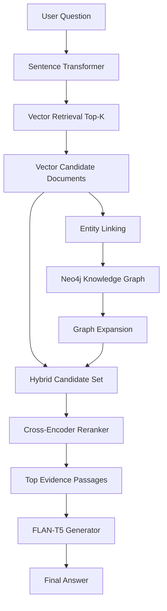

# GraphRAG Multi-Hop Question Answering

A hybrid Retrieval-Augmented Generation (RAG) system designed for **multi-hop question answering** by combining semantic vector retrieval with knowledge-graph traversal.

The project compares a traditional Vector RAG baseline against a GraphRAG pipeline using the HotpotQA dataset.

## Overview

Traditional vector retrieval can retrieve passages that are semantically similar to a question, but multi-hop questions often require connecting information distributed across multiple documents.

This project addresses that limitation by combining:

- Sentence-transformer embeddings for semantic retrieval
- Neo4j for knowledge-graph storage and traversal
- LLM-based entity and relationship extraction
- Entity resolution and graph construction
- Graph-based evidence expansion
- Cross-encoder reranking
- FLAN-T5 answer generation
- Streamlit user interface
- FastAPI REST API

## Architecture




## Reconstructing the Neo4j Knowledge Graph

The repository includes the processed graph exports in:

```text
data/graph/
├── graphrag_chunks.csv
├── graphrag_entities.csv
├── graphrag_mentions.csv
└── graphrag_relationships.csv
```
